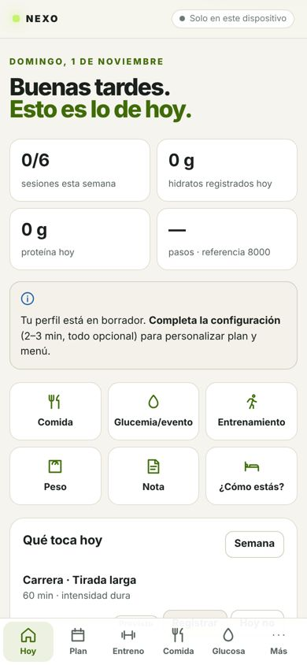
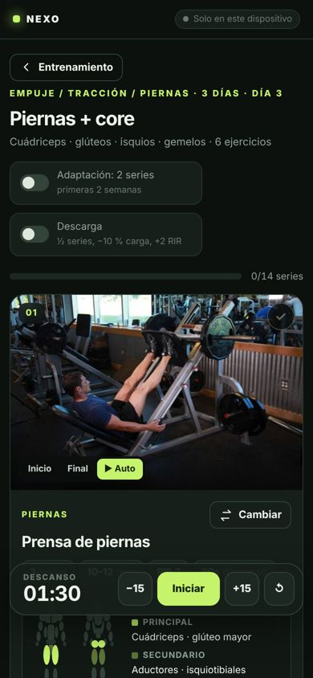
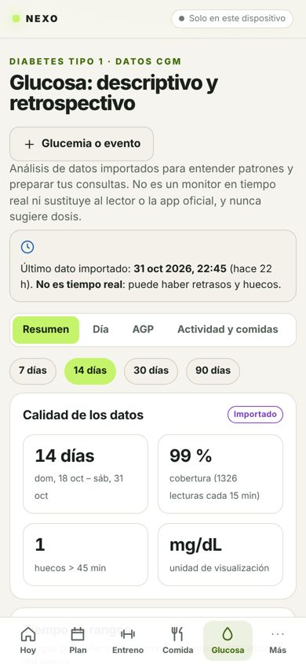
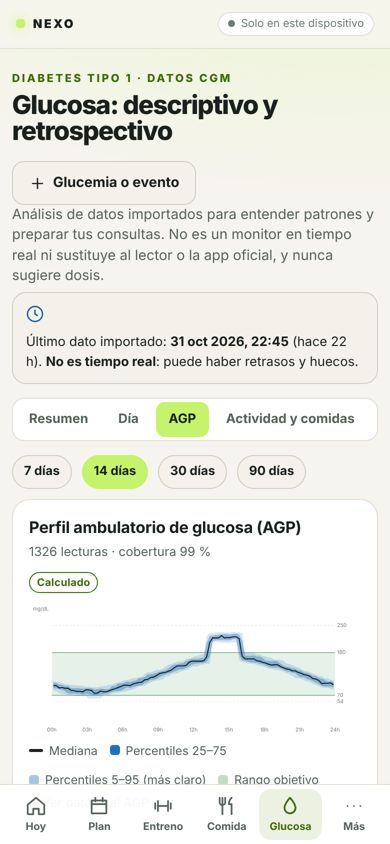
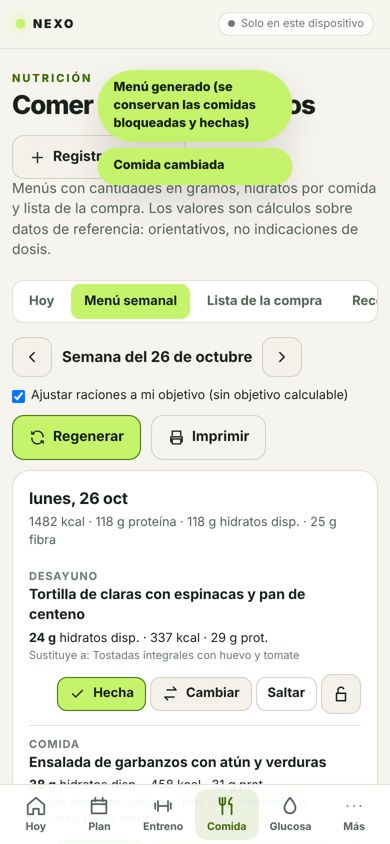

# NEXO — Personal Health & Performance OS

App personal (PWA, local-first) que une **entrenamiento** (gimnasio, carrera, bici, cinta), **nutrición** (menús, hidratos por comida, lista de la compra), **diabetes tipo 1** (datos CGM importados de LibreView: TIR, AGP, episodios, contexto con actividad y comidas), **recuperación** y un **asistente IA** (Claude por defecto) que propone cambios que tú apruebas.

> No es un dispositivo médico: nunca calcula ni sugiere dosis de insulina, ratios ni correcciones. Ver [`docs/SAFETY_AND_PRIVACY.md`](docs/SAFETY_AND_PRIVACY.md).

| Hoy | Sesión (claro / oscuro) | Diabetes | AGP | Menú |
| --- | --- | --- | --- | --- |
|  |  |  |  |  |

## Características
- **Offline de verdad**: todos los datos en IndexedDB; todas las pantallas y fotos precacheadas. Funciona en modo avión.
- **Gimnasio**: 56 ejercicios con fotos reales (inicio/final) y mapa muscular, rutinas (2 originales + full body + constructor con arrastrar), sesión serie a serie (kg, reps, RIR), temporizador de descanso robusto al bloqueo de pantalla, Wake Lock, progresión doble sugerida («Hoy: X kg · Aplicar»), 1RM estimado, estancamiento, descarga, sustituciones.
- **Carrera/bici/cinta**: registro manual, TCX/GPX, Polar AccessLink; planes 5K/10K/media prudentes; carga sRPE y ratio agudo:crónico (descriptivos).
- **Plan semanal**: motor de reglas auditable (sin días duros seguidos, descanso, interferencia piernas→carrera), plan original vs vigente vs real, bloqueos y propuestas reversibles.
- **Nutrición**: alimentos con fuente y licencia (USDA dominio público, Open Food Facts ODbL, etiqueta), hidratos totales vs disponibles, crudo/cocinado, 28 recetas, menú determinista con sustituciones, lista de la compra con despensa, objetivos estimados con rango, fórmula y margen.
- **Diabetes**: importación CSV LibreView (ES/EN, mg/dL o mmol/L, DST, duplicados, mapeo manual), informes PDF AGP de LibreLink/LibreView (métricas resumidas, periodo, original cifrado y detección de duplicados), métricas del consenso con cobertura, AGP, episodios, vista diaria con comidas/actividad/eventos, observaciones ejercicio↔glucosa, protocolo personal, informe imprimible para consulta.
- **Asistente IA** (opcional): Claude u OpenAI vía servidor; herramientas de solo lectura sobre tus datos (glucosa solo agregada) y de propuesta con aprobación; guardarraíles clínicos.
- **Privacidad**: sin cuentas por defecto; nube (Supabase con RLS) e IA son opt-in y granulares; exportar/borrar todo.

## Uso rápido
```bash
npm install
npm run dev                     # http://localhost:3000
npm run build && npm start      # producción (service worker activo)
```
Sin variables de entorno funciona todo salvo sincronización, IA y Polar. Configúralas con [`.env.example`](.env.example).

## Calidad
```bash
npm run lint       # TypeScript estricto + comprobaciones de seguridad (secretos, server-only)
npm test           # 108 tests unitarios: CGM, nutrición, progresión, planificador, guardarraíles, IA, sync, SQL+RLS (PGlite)
npm run test:e2e   # Playwright móvil contra la build: flujos completos + modo avión
```
CI en `.github/workflows/ci.yml`.

## Despliegue
1. Vercel → importar el repositorio (Next.js detectado automáticamente).
2. (Opcional) Supabase: aplicar `supabase/migrations/*.sql`, activar magic link, definir `NEXT_PUBLIC_SUPABASE_*`, desactivar registros públicos tras crear tu usuario.
3. (Opcional) IA: `ANTHROPIC_API_KEY` (+ `ALLOWED_EMAILS`). Polar: `POLAR_CLIENT_ID/SECRET/REDIRECT_URI` + `TOKEN_ENCRYPTION_KEY`.

## Fotos y voz en el asistente
Puedes adjuntar fotos de tu nevera o de etiquetas, PDF y archivos de texto; también dictar en navegadores compatibles. El asistente puede proponer productos nuevos y usarlos en una comida, con aprobación antes de guardar. [Formatos, privacidad y uso](docs/ASSISTANT_INPUTS.md).

## Documentación
[Visión](docs/PRODUCT_VISION.md) · [Arquitectura](docs/ARCHITECTURE.md) · [Modelo de datos](docs/DATA_MODEL.md) · [Seguridad y privacidad](docs/SAFETY_AND_PRIVACY.md) · [Integraciones](docs/INTEGRATIONS.md) · [Roadmap](docs/ROADMAP.md) · [Decisiones](docs/DECISIONS.md) · [Estado](PROJECT_STATUS.md) · [Prompt maestro (Claude)](docs/PROMPT_MAESTRO_CLAUDE.md)

## Créditos
Fotos de ejercicios: [free-exercise-db](https://github.com/yuhonas/free-exercise-db) (dominio público). Alimentos: USDA FoodData Central (dominio público); Open Food Facts (ODbL) bajo demanda.
